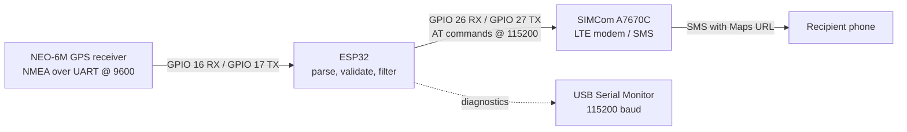
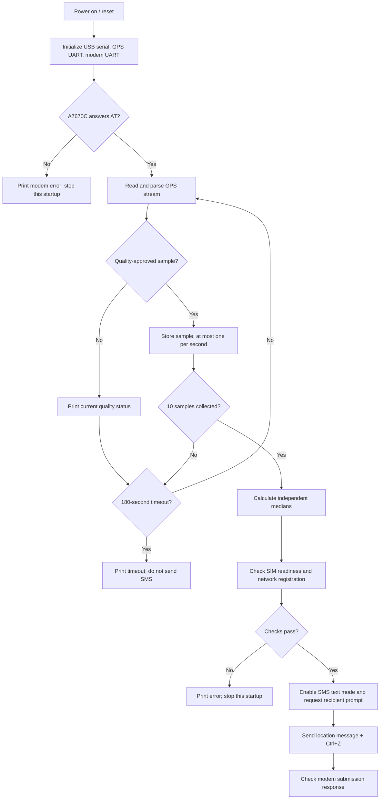
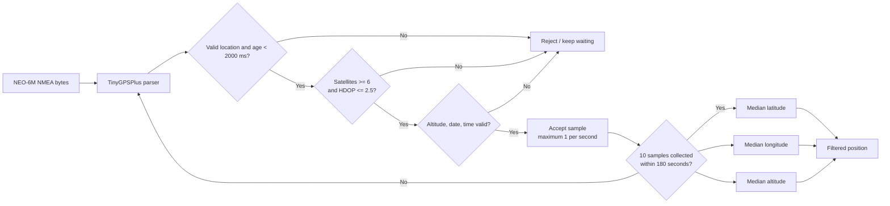
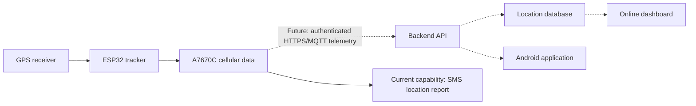

# GPS-Based Vehicle Tracking System

A prototype vehicle-location tracker built around an **ESP32**, a **NEO-6M GPS receiver**, and a **SIMCom A7670C 4G LTE modem**. The firmware acquires and quality-checks GPS fixes, filters a set of position samples, and sends a Google Maps link and position details by SMS.

> **Implementation status:** GPS acquisition, ESP32 integration, A7670C communication, and SMS-based location reporting have been tested successfully. A backend, online dashboard, continuous cellular data service, and Android application are future work; they are not implemented in the current firmware.

## Contents

- [Project overview](#project-overview)
- [Project code](#project-code)
- [Project report review](#project-report-review)
- [Project demonstration](#project-demonstration)
- [Circuit schematic and connections](#circuit-schematic-and-connections)
- [Block diagrams](#block-diagrams)
- [Project file structure](#project-file-structure)
- [Hardware and software requirements](#hardware-and-software-requirements)
- [Setup and installation](#setup-and-installation)
- [Testing and results](#testing-and-results)
- [Limitations and future scope](#limitations-and-future-scope)
- [References and acknowledgments](#references-and-acknowledgments)

## Project Overview

The prototype reads position and fix-quality data from a NEO-6M module over UART. The ESP32 accepts a series of valid GPS samples, calculates a median latitude, longitude, and altitude, then uses the A7670C modem to send an SMS containing a Google Maps query link, UTC time, date, altitude, satellite count, and HDOP.

### Objectives

- Obtain a GPS position using a standalone receiver.
- Integrate the GPS and cellular modem with an ESP32 using hardware UARTs.
- Avoid reporting a position until GPS quality checks pass.
- Reduce the effect of occasional sample outliers using a median filter.
- Send a human-readable location report by SMS.

### Features implemented

- GPS NMEA parsing through the TinyGPSPlus library.
- Fix validation for location freshness, satellite count, HDOP, altitude, date, and time.
- Up to 10 accepted GPS samples, with no more than one sample taken per second.
- Independent median filtering of latitude, longitude, and altitude.
- A 180-second GPS acquisition timeout; no SMS is sent if the required samples are not collected.
- A7670C AT-command communication, SIM readiness check, network registration check, and SMS text-mode submission.
- Google Maps link formatting from the filtered coordinates.

### Current implementation status

| Capability | Status |
|---|---|
| ESP32 + NEO-6M GPS acquisition | Implemented and tested |
| GPS quality checks and median filtering | Implemented in firmware |
| ESP32 + A7670C serial communication | Implemented and tested |
| SMS location report | Implemented and tested |
| Repeated/continuous tracking | Not implemented; one report attempt per startup |
| Backend, cloud storage, and dashboard | Future development |
| Android application | Future development |

## Project Code

The current firmware is [`GPS_tracker_code.ino`](<GPS_tracker_initial_testing_v1.0/project files/test_code/GPS_tracker_code.ino>). It runs its work from `setup()`: initialize serial ports, check the modem, collect and filter GPS samples, and attempt one SMS. `loop()` is intentionally empty.

### Important functions

| Function | Purpose |
|---|---|
| `readResponse(timeout)` | Reads modem bytes until a terminal `OK`, `ERROR`, or `+CMS ERROR` response is found or the timeout expires. Also echoes received bytes to the USB Serial Monitor. |
| `sendAT(cmd, expected, timeout)` | Sends an AT command and checks for the expected response, rejecting responses containing `ERROR`. |
| `waitForPrompt(timeout)` | Waits for the `>` prompt before the SMS message body is sent. |
| `gpsQualityGood()` | Requires a valid, recent location, at least 6 satellites, HDOP no greater than 2.5, and valid altitude, date, and time. |
| `acquireStableGPS()` | Parses GPS serial data, accepts up to 10 quality-approved samples at most once per second, and stops after 180 seconds if it cannot collect enough. |
| `medianOf(values, count)` | Sorts a copy of a sample array and returns its median. The function is applied separately to latitude, longitude, and altitude. |
| `sendLocationSMS(lat, lon, altitude)` | Builds the Maps URL and message, checks SIM and registration state, configures text mode, submits the message, and looks for modem submission confirmation. |

### GPS data processing and filtering

TinyGPSPlus decodes the NEO-6M's serial NMEA stream. A sample can be accepted only when all of the following are true:

- Location is valid and younger than **2,000 ms**.
- Satellite count is valid and at least **6**.
- HDOP is valid and no greater than **2.5**.
- Altitude, date, and time are valid.

The firmware collects **10** such samples, sampling no more than once per second. It then calculates three medians: one each for latitude, longitude, and altitude. These are independent medians, not a single selected sample. If the ten samples are not collected within **180 seconds**, acquisition fails and the firmware does not proceed to SMS transmission.

### Modem commands used

The firmware sends these commands during its flow:

| AT command / sequence | Use |
|---|---|
| `AT` | Initial modem responsiveness check |
| `AT+CPIN?` | Confirm that the SIM reports `READY` |
| `AT+CREG?` | Check for home (`1`) or roaming (`5`) registration |
| `AT+CMGF=1` | Select SMS text mode |
| `AT+CMGS="<destination>"` | Start an SMS to the configured destination |
| Message body followed by Ctrl+Z | Submit the SMS; firmware looks for `+CMGS:` and `OK` |

An `OK`/`+CMGS:` response indicates that the modem accepted the SMS submission; it is not by itself proof of delivery to the recipient.

### Libraries and code dependencies

- **TinyGPSPlus** (`TinyGPSPlus.h`) — GPS/NMEA parsing.
- **`math.h`** — included by the sketch; no external math package is required.
- **ESP32 Arduino core** — provides `HardwareSerial`, `Serial`, and the ESP32 Arduino APIs.
- **Arduino `String` and standard C/C++ facilities** — used by the firmware; no separate install is listed in the project.

The modem destination is configured by the `PHONE_NUMBER` constant in the sketch. Set it to a number you control before testing, and avoid publishing a real personal number in a public repository.

## Project Report Review

**No written project report was found in the repository files inspected.** The available project materials are the firmware, one schematic PDF, and three hardware photographs. Therefore, a report-specific review, report results, and report conclusions cannot be verified from the checked-in files.

Based on the available firmware and the stated test status, the prototype work completed includes GPS acquisition and quality gating, ESP32 integration, A7670C communication, coordinate filtering, and SMS location reporting. The principal implementation limitation visible in the sketch is that it attempts a single location report during startup rather than continuous tracking. No numerical test logs or measured accuracy figures are present in the repository.

## Project Demonstration

### Hardware photographs

These photographs are present in the repository and show the assembled prototype on a breadboard.

| Prototype photograph | View |
|---|---|
|  | Close-up of the breadboard assembly |
|  | Overhead view of the connected modules |
|  | Additional overhead view of the prototype |

### Other demonstration evidence

The following assets were **not found** in the repository. They are listed as placeholders so that future evidence can be added without implying it is already available:

- **Serial Monitor output:** _Placeholder — no captured Serial Monitor screenshot or log is currently included._
- **SMS screenshot:** _Placeholder — no received SMS screenshot is currently included._
- **Google Maps location screenshot:** _Placeholder — no Maps screenshot is currently included._

## Circuit Schematic and Connections

The repository includes the one-page **[initial circuit setup schematic](<GPS_tracker_initial_testing_v1.0/schematic v1.0/circuit_schematic.pdf>)**. The UART pin assignments and baud rates below are taken from the firmware. The source code does not define power-supply voltage/current or every module power pin, so those details must be checked against the exact ESP32 board and modem/GPS carrier-board documentation before powering the assembly.

### Firmware UART assignments

| Connection | ESP32 pin | Other module pin | UART configuration |
|---|---:|---|---|
| GPS receive | GPIO 16 (`GPS_RX`) | NEO-6M TX | 9,600 baud, 8-N-1 |
| GPS transmit | GPIO 17 (`GPS_TX`) | NEO-6M RX | 9,600 baud, 8-N-1 |
| Modem receive | GPIO 26 (`MODEM_RX`) | A7670C TX | 115,200 baud, 8-N-1 |
| Modem transmit | GPIO 27 (`MODEM_TX`) | A7670C RX | 115,200 baud, 8-N-1 |
| USB Serial Monitor | ESP32 USB serial | Development computer | 115,200 baud |

UART data lines are crossed: ESP32 RX connects to module TX, and ESP32 TX connects to module RX. Connect grounds together. Provide each board with a supply appropriate to its specific carrier board; **do not infer supply requirements from the UART settings or power a modem directly from an ESP32 GPIO**. Confirm the logic-level requirements of the exact boards before connecting their UARTs.

### Connection diagram (signal-level)

```text
NEO-6M TX  ───────────────> ESP32 GPIO 16 (GPS_RX), UART2 @ 9600
NEO-6M RX  <─────────────── ESP32 GPIO 17 (GPS_TX), UART2 @ 9600

A7670C TX  ───────────────> ESP32 GPIO 26 (MODEM_RX), UART1 @ 115200
A7670C RX  <─────────────── ESP32 GPIO 27 (MODEM_TX), UART1 @ 115200

ESP32 GND ───────────────── GPS/module GND (common reference)
ESP32 USB serial ────────── Development computer, 115200 baud
```

This text diagram captures the firmware's UART mapping, not a replacement for the linked hardware schematic or the module-specific power design.

## Block Diagrams

### Overall system architecture



### Firmware execution flow



### GPS data-processing flow



### Proposed future cloud architecture (not implemented)



Dashed links represent proposed work only. The checked-in firmware currently uses the modem for SMS and does not implement cellular internet data transmission, a backend, dashboard, or mobile app.

## Project File Structure

```text
.
├── .gitignore
├── README.md
└── GPS_tracker_initial_testing_v1.0/
    ├── project files/
    │   └── test_code/
    │       └── GPS_tracker_code.ino
    ├── schematic v1.0/
    │   └── circuit_schematic.pdf
    └── testing images/
        ├── 1000164790.jpg
        ├── 1000164791.jpg
        └── 1000164792.jpg
```

| Path | Purpose |
|---|---|
| [`README.md`](README.md) | Project documentation and setup guide |
| [`.gitignore`](.gitignore) | Present in the repository; currently empty |
| [`GPS_tracker_code.ino`](<GPS_tracker_initial_testing_v1.0/project files/test_code/GPS_tracker_code.ino>) | ESP32 firmware for GPS acquisition, filtering, modem control, and SMS |
| [`circuit_schematic.pdf`](<GPS_tracker_initial_testing_v1.0/schematic v1.0/circuit_schematic.pdf>) | Initial circuit setup schematic |
| [`testing images/`](<GPS_tracker_initial_testing_v1.0/testing images/>) | Three photographs of the hardware prototype |

No written project report, separate test-log directory, or Serial/SMS/Maps screenshot files were present in the inspected project tree.

## Hardware and Software Requirements

### Hardware

| Component | Role |
|---|---|
| ESP32 development board | Runs the firmware and provides hardware UARTs |
| NEO-6M GPS receiver and antenna | Supplies position, altitude, time, date, satellite count, and HDOP |
| SIMCom A7670C modem board and antenna | Cellular network access and SMS transmission |
| SIM and SMS-capable cellular service | Required for network registration and outgoing SMS |
| Appropriate power sources/regulators and wiring | Supplies the boards according to their own electrical specifications |
| Development computer and USB cable | Firmware upload and Serial Monitor |

The photographs show the modules assembled on a breadboard. The exact carrier-board revisions and power circuitry are not documented in the source files; verify their individual requirements before building.

### Software

- Arduino IDE with an ESP32 board package compatible with the specific development board.
- TinyGPSPlus Arduino library.
- USB serial driver if required by the ESP32 board.
- A serial terminal such as Arduino IDE Serial Monitor.

## Setup and Installation

1. **Install Arduino IDE** and install the ESP32 platform through Boards Manager.
2. **Install TinyGPSPlus** through Library Manager (search for `TinyGPSPlus`).
3. **Open the sketch:** [`GPS_tracker_code.ino`](<GPS_tracker_initial_testing_v1.0/project files/test_code/GPS_tracker_code.ino>).
4. **Select the correct ESP32 board and USB port** for the development board being used. The repository does not specify an exact ESP32 board model.
5. **Set the SMS destination** by editing the `PHONE_NUMBER` constant. Use an SMS-capable number you control; do not publish personal numbers.
6. **Wire UART signals** as shown in [Circuit Schematic and Connections](#circuit-schematic-and-connections). Cross TX/RX, connect a common ground, and verify power and logic levels against the exact module/carrier-board documentation.
7. **Connect antennas and SIM:** use the GPS antenna with a clear view of the sky and a provisioned SIM with SMS service in the modem.
8. **Power the modules appropriately.** The modem's supply must meet the exact modem board's requirements; the firmware and repository do not specify those values.
9. **Upload the sketch** using Arduino IDE.
10. **Open Serial Monitor at 115200 baud** and reset the ESP32. Keep the GPS antenna still under open sky while the firmware acquires its samples.
11. **Observe the output:** the firmware reports modem response, GPS sample acceptance or waiting status, filtered coordinates, and SMS success/failure messages. The location SMS is attempted once per startup if acquisition and modem checks succeed.

## Testing and Results

The following completed test status is based on the project owner's statement. The repository does not include captured numerical logs, test procedures, or screenshots, so no coordinates, accuracy measurements, timing results, or delivery receipts are claimed here.

| Test area | Result/status | Evidence available in repository |
|---|---|---|
| GPS acquisition | Tested successfully; firmware requires ten accepted quality samples before proceeding | Firmware source and hardware photos; no captured GPS log |
| ESP32 integration | Tested successfully with GPS and modem UART interfaces | Firmware source and hardware photos |
| A7670C communication | Tested successfully; sketch checks AT responsiveness and SIM readiness | Firmware AT-command logic; no captured modem transcript |
| Network registration | Checked by the SMS workflow for home or roaming registration | `AT+CREG?` handling in source; no separate registration log |
| SMS location reporting | Tested successfully per project status; message includes a Maps URL and GPS details | Firmware message construction and SMS logic; no received SMS screenshot |

The firmware treats `+CMGS:` followed by `OK` as successful modem submission. This is a modem-side acceptance signal and should not be represented as end-to-end delivery confirmation without separate recipient-side evidence.

## Limitations and Future Scope

### Current limitations

- The sketch attempts one location SMS per power-up/reset; it does not continuously track or send periodic updates.
- GPS acquisition depends on satellite visibility and aborts after the fixed 180-second timeout.
- GPS quality limits and the sample count are constants in the source, not configurable at runtime.
- The SMS destination is a firmware constant and must be changed before deployment.
- The code does not implement a backend, data persistence, cellular internet telemetry, or a user interface.
- The repository has no written report, measured accuracy data, captured serial logs, or SMS/Maps screenshots.

### Proposed future developments

1. Add authenticated cellular data transfer from the A7670C to a backend API using a documented protocol such as HTTPS or MQTT.
2. Build a backend service to authenticate devices, ingest location updates, and store position history.
3. Create an online dashboard for live and historical vehicle positions.
4. Develop an Android application for viewing vehicles and receiving alerts.
5. Add configurable reporting intervals, retry/error handling, and appropriate privacy and device-security controls.

These are planned directions only; they are not present in the checked-in firmware.

## References and Acknowledgments

- [Espressif Arduino Core for ESP32](https://docs.espressif.com/projects/arduino-esp32/en/latest/)
- [TinyGPSPlus library](https://github.com/mikalhart/TinyGPSPlus)
- [u-blox NEO-6 positioning modules documentation](https://www.u-blox.com/en/product/neo-6-series)
- [SIMCom A7670 Series product information](https://www.simcom.com/product/A7670X.html) — consult the hardware-specific AT command and hardware design manuals for the exact module/carrier board in use.
- [Arduino IDE documentation](https://docs.arduino.cc/software/ide/)
- [Google Maps URL format](https://developers.google.com/maps/documentation/urls/get-started)

Thanks to the open-source maintainers of the Arduino ESP32 core and TinyGPSPlus library, and to the project contributors who assembled and tested the prototype.